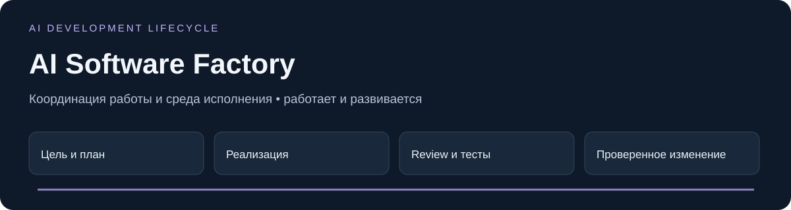
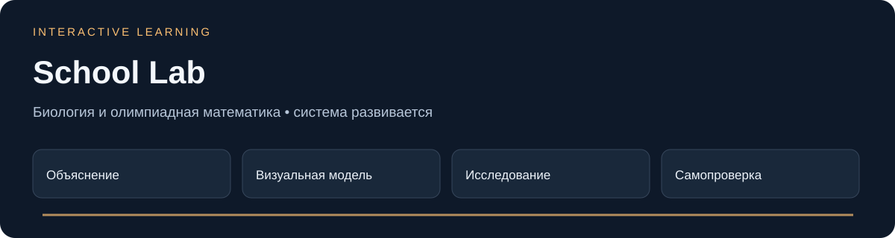

**For English, see [the English version](en/README.md).**

# Дмитрий Науменко
### Senior AI Engineer / AI Tech Lead

Проектирую и разрабатываю AI-системы, которые связывают данные, инструменты и знания предметной области и помогают решать реальные задачи. Мне интересен весь путь: от пользовательской потребности и архитектуры до проверки результата и дальнейшего развития продукта.

[LinkedIn](https://www.linkedin.com/in/naumenko-d/) · [Telegram](https://t.me/naumenko_ds) · [Email](mailto:dima-post2009@yandex.com) · [Проекты и примеры](https://dmitrii-naumenko.github.io/portfolio/)

## Коммерческие проекты с публичными материалами

Ниже — несколько проектов из моего коммерческого опыта, которые можно показать через публичные страницы продуктов и описания внедрений.

Разработка финансового AI-ассистента **FinGPT** и продукта **INNOMA**, Telegram-бот для управления складом в **Ultima BusinessWare**, участие во внедрении **Ivanti** в аэропорту Краснодара.

[Выбранные работы и публичные источники](experience/README.md)

## Личные AI-проекты

### Autodiary
**A Personal AI Platform for Learning and Decision-Making · работает и развивается**

Персональная AI-платформа для обучения и решений: интерактивная библиотека и тренажёры, отдельное приложение английской практики, планы поездок, личные консультации, новости и исследования. Эти направления используют накопленный контекст и обратную связь; аналитика жизненных показателей — один из компонентов.

**Инженерный фокус:** самостоятельные модули, доступ к релевантному контексту через API/MCP и каталоги, проверяемые источники, интерактивные артефакты и преемственность между задачами.

[Разобрать кейс](projects/autodiary/README.md) · [Пример аналитики](https://dmitrii-naumenko.github.io/portfolio/demos/autodiary.html)

### AI Software Factory
**Automating the Development Lifecycle · работает и развивается**

Развиваю AI-фабрику, которая превращает цель разработки в согласованный цикл планирования, реализации, review и проверки. Factory координирует работу, а engineering harness предоставляет среду исполнения. Основой служит опыт создания работающих проектных AI-workflows.

**Инженерный фокус:** координация coding-агентов, обратная связь от review и тестов, воспроизводимые проверки и контроль существенных решений разработчиком.

[Разобрать кейс](projects/factory.md) · [Как работает завод](https://dmitrii-naumenko.github.io/portfolio/demos/factory.html)

### School Lab
**From Textbooks to Interactive Learning · биология и олимпиадная математика**

Большая развивающаяся система по биологии и олимпиадной математике: курсы, уроки и модули с объяснениями, визуальными моделями и самопроверкой. Математическое направление развивается как серия занятий. Открытая лаборатория дробей — один учебный пример; готовые страницы работают офлайн.

**Инженерный фокус:** подготовка содержания с AI, независимая сверка с источником, общая структура уроков, шаблоны и автоматическая валидация.

[Разобрать кейс](projects/school.md) · [Попробовать лабораторию](https://dmitrii-naumenko.github.io/portfolio/demos/school.html)

## Архитектурный опыт и подтверждения

- [ML System Design Challenge 2023](experience/system-design.md) — командный проект банковского антифрода: design document и выступление.
- **AI News 2023 — 2-е место на хакатоне**, участие техническим экспертом в хакатонах, профессиональные сертификаты и обучение — [выбранные подтверждения](credentials/README.md).

В описаниях кейсов показаны личный вклад, существенные решения, проверка и фактическая стадия проекта. Данные в аналитическом примере Autodiary синтетические. Открытое занятие School Lab показывает один фрагмент развивающейся учебной системы.
