# Learning, certifications, and expert participation

[Русская версия](README.md) · [Back to the portfolio](../en/README.md)

Selected evidence of learning and professional participation, newest first. Image previews open directly on GitHub; original documents are preserved unchanged. Course completion, professional certification, competition results, and expert participation are recorded separately.

| Year | Credential | Evidence | Organization / event | Documents |
| --- | --- | --- | --- | --- |
| 2025 | **Project: Building Ambient Agents with LangGraph** | Course completion, July 28 | LangChain Academy | [Preview](previews/2025-langgraph-ambient-agents.jpg) · [PDF](files/2025-langgraph-ambient-agents.pdf) |
| 2024 | **Data-driven Decision Making. Data Science** | Course completion | karpov.courses | [Preview](previews/2024-data-driven-decisions.jpg) · [Original JPG](files/2024-data-driven-decisions.jpg) |
| 2023 | **AtomicHack** | Hackathon expert | Rosatom Corporate Academy | [Preview](previews/2023-atomichack-expert.jpg) · [PDF](files/2023-atomichack-expert.pdf) |
| 2023 | **International hackathon** | Hackathon expert | Digital Breakthrough: AI Season | [Preview](previews/2023-international-hackathon-expert.jpg) · [Original PNG](files/2023-international-hackathon-expert.png) |
| 2023 | **Receipt of accounting documents** | Case expert | Digital Breakthrough: AI Season | [Preview](previews/2023-rzd-document-processing-expert.jpg) · [PDF](files/2023-rzd-document-processing-expert.pdf) |
| 2023 | **Safe Route** | Case expert | Digital Breakthrough: AI Season | [Preview](previews/2023-rzd-safe-route-expert.jpg) · [PDF](files/2023-rzd-safe-route-expert.pdf) |
| 2023 | **AI News** | Second place | AI News | [Preview](previews/2023-ai-news-finalist.jpg) · [PDF](files/2023-ai-news-finalist.pdf) |
| 2023 | **Vessel scheduling** | Case expert | Digital Breakthrough: AI Season | [Preview](previews/2023-vessel-scheduling-expert.jpg) · [PDF](files/2023-vessel-scheduling-expert.pdf) |
| 2023 | **MTS Machine Learning Cup** | Participation; top 50% of the leaderboard | MTS Digital / ODS | [Preview](previews/2023-mts-ml-cup-top-50-percent.jpg) · [PDF](files/2023-mts-ml-cup-top-50-percent.pdf) |
| 2023 | **Simulator ML** | Practical course; the saved progress screen shows 100% completion in every task group | karpov.courses | [Preview](previews/2023-simulator-ml.jpg) · [Original PNG](files/2023-simulator-ml.png) |
| 2022 | **Data Scientist** | Professional training course, 400 hours | Practicum by Yandex | [Preview](previews/2022-yandex-data-scientist.jpg) · [PDF, 2 pages](files/2022-yandex-data-scientist.pdf) |
| 2022 | **HackWagon'22** | Finalist | Freight One | [Preview](previews/2022-hackwagon-finalist.jpg) · [PDF](files/2022-hackwagon-finalist.pdf) |
| 2022 | **Certified Administrator for Ivanti Service Manager** | Professional certification | Ivanti | [Preview](previews/2022-ivanti-certified-administrator.jpg) · [PDF](files/2022-ivanti-certified-administrator.pdf) |
| 2022 | **ITIL 4 Specialist: Create, Deliver and Support** | Professional certification | PeopleCert / AXELOS | [Preview](previews/2022-itil-create-deliver-support.jpg) · [PDF](files/2022-itil-create-deliver-support.pdf) |
| 2021 | **ITIL Foundation in IT Service Management, ITIL 4 Edition** | Professional certification | PeopleCert / AXELOS | [Preview](previews/2021-itil-foundation.jpg) · [PDF](files/2021-itil-foundation.pdf) |

View document previews

### 2025 · LangChain Academy

[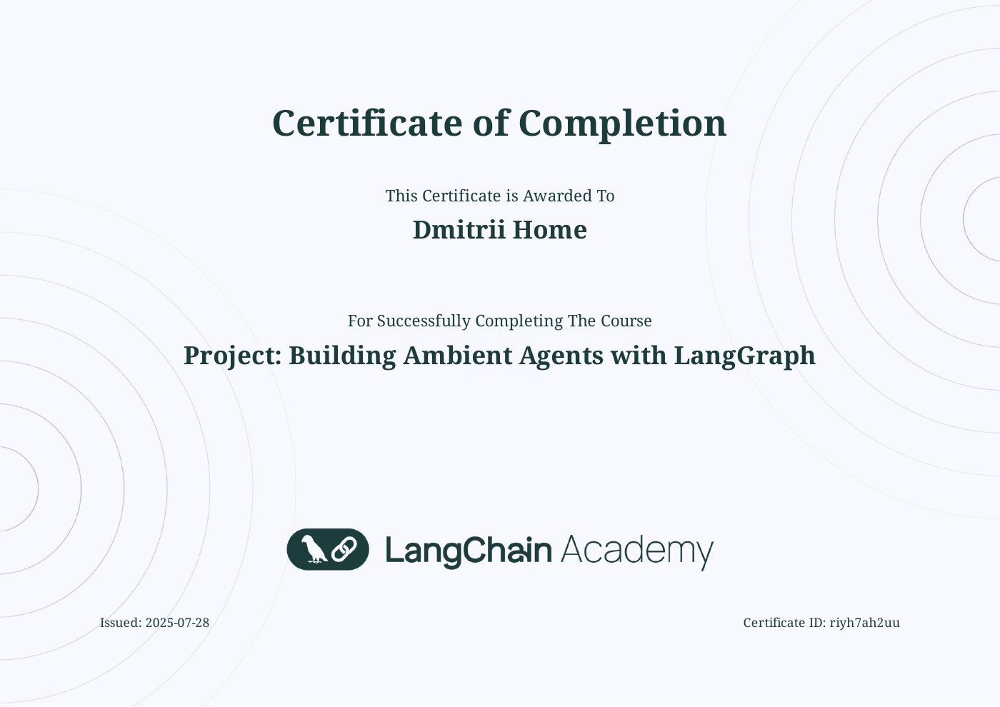](files/2025-langgraph-ambient-agents.pdf)

### 2024 · Data-driven Decision Making

[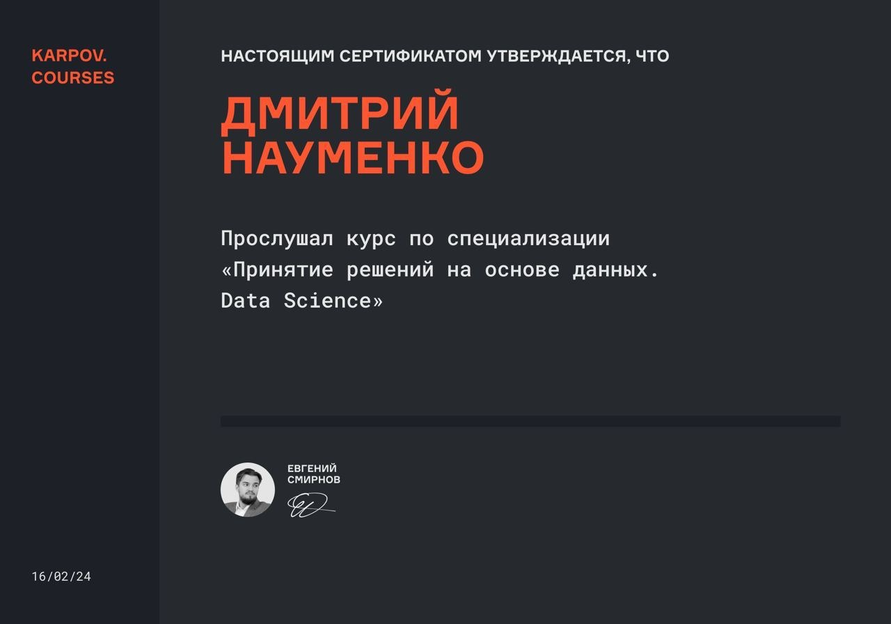](files/2024-data-driven-decisions.jpg)

### 2023 · Expert participation

[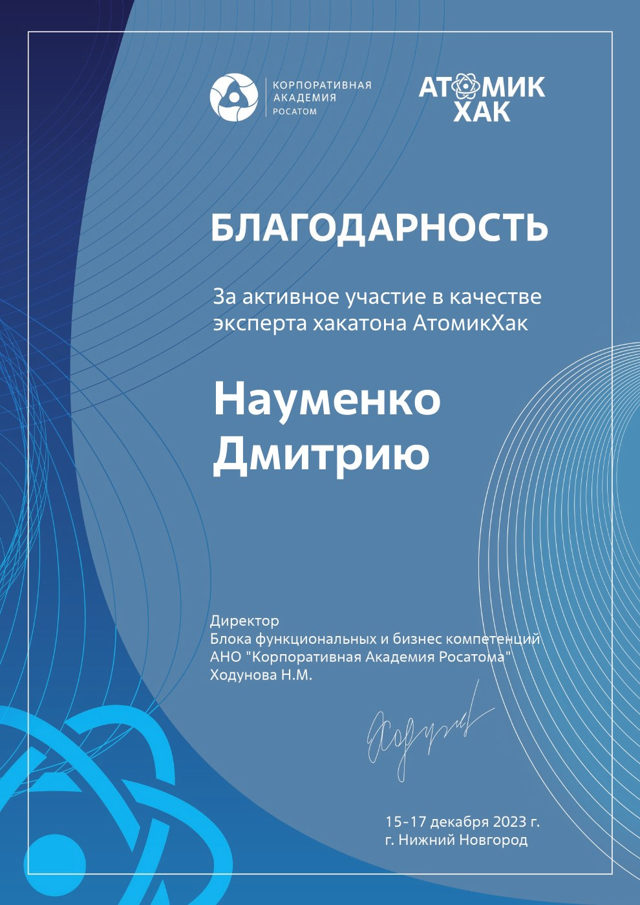](files/2023-atomichack-expert.pdf)

[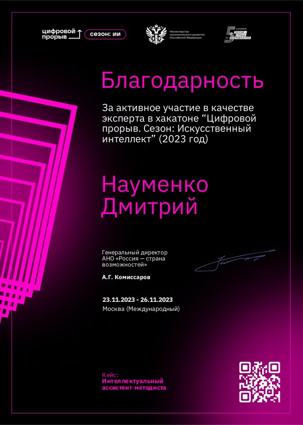](files/2023-international-hackathon-expert.png)

[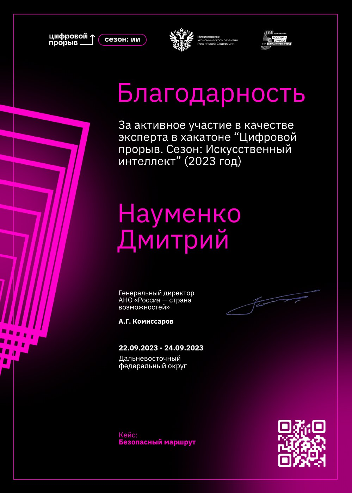](files/2023-rzd-safe-route-expert.pdf)

[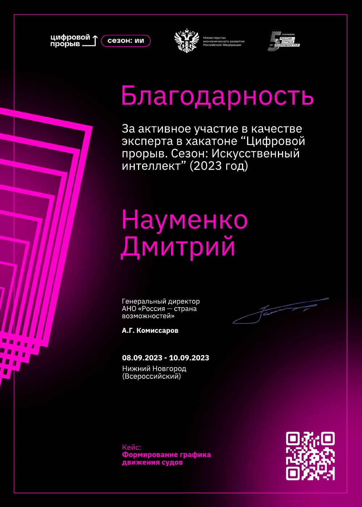](files/2023-vessel-scheduling-expert.pdf)

### 2023 · Competitions and learning

[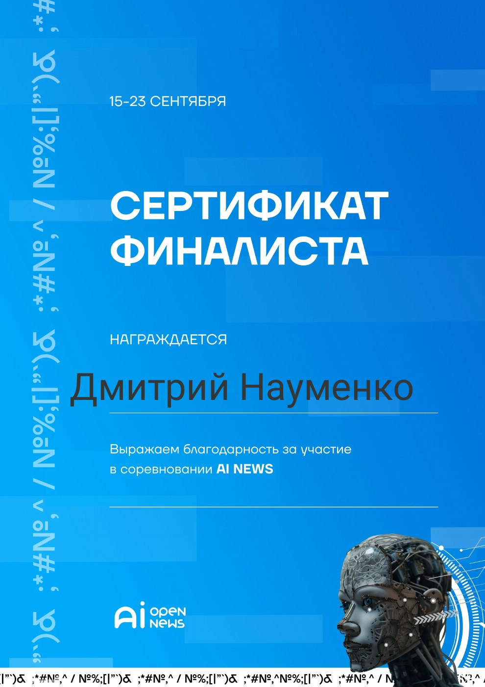](files/2023-ai-news-finalist.pdf)

[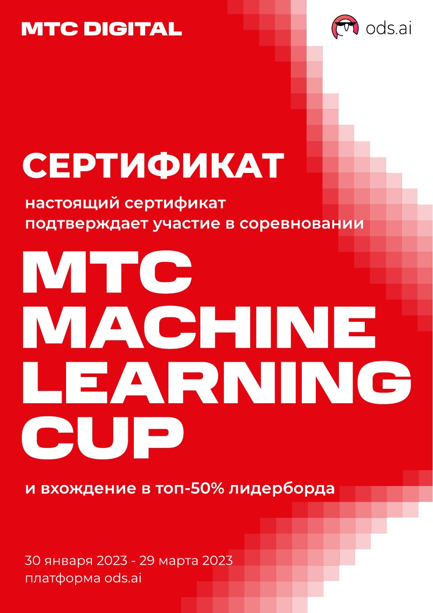](files/2023-mts-ml-cup-top-50-percent.pdf)

[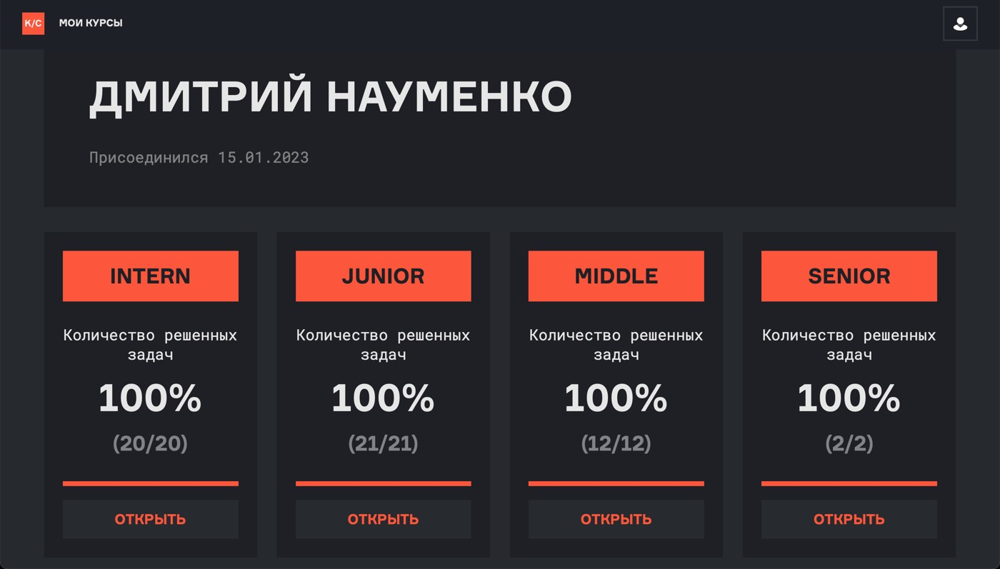](files/2023-simulator-ml.png)

### 2022 · Learning, competitions, and certifications

[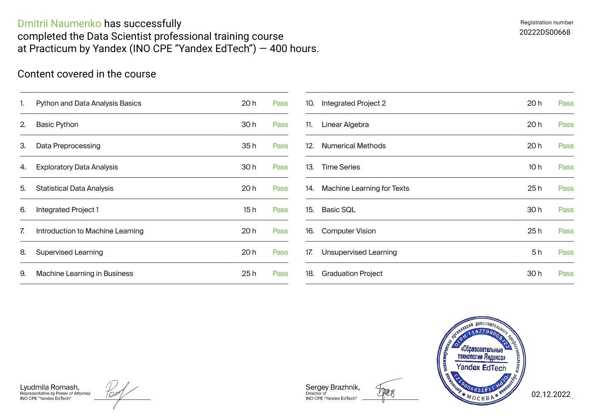](files/2022-yandex-data-scientist.pdf)

[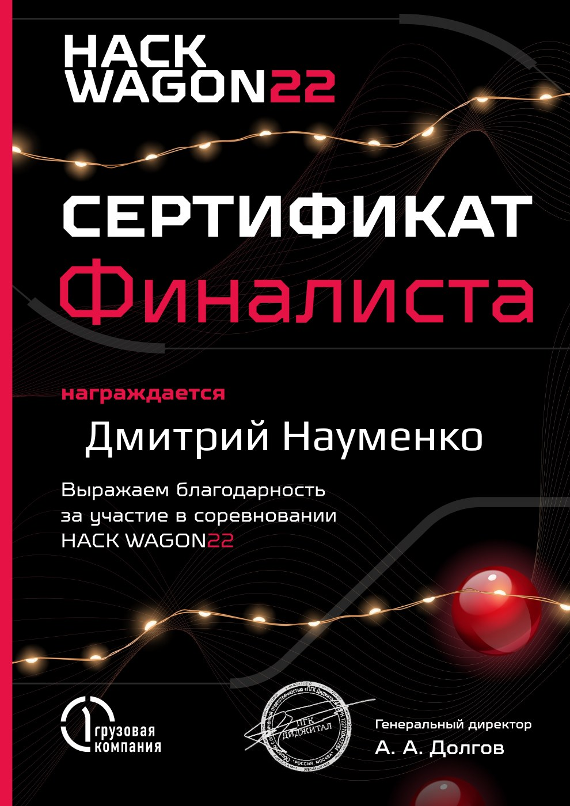](files/2022-hackwagon-finalist.pdf)

[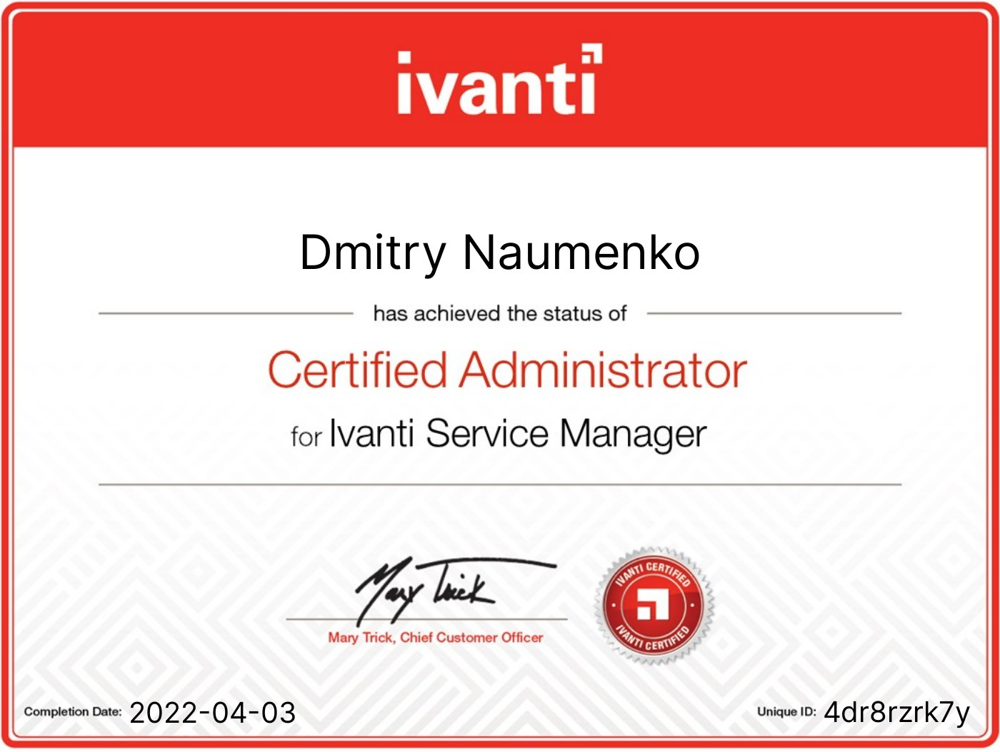](files/2022-ivanti-certified-administrator.pdf)

[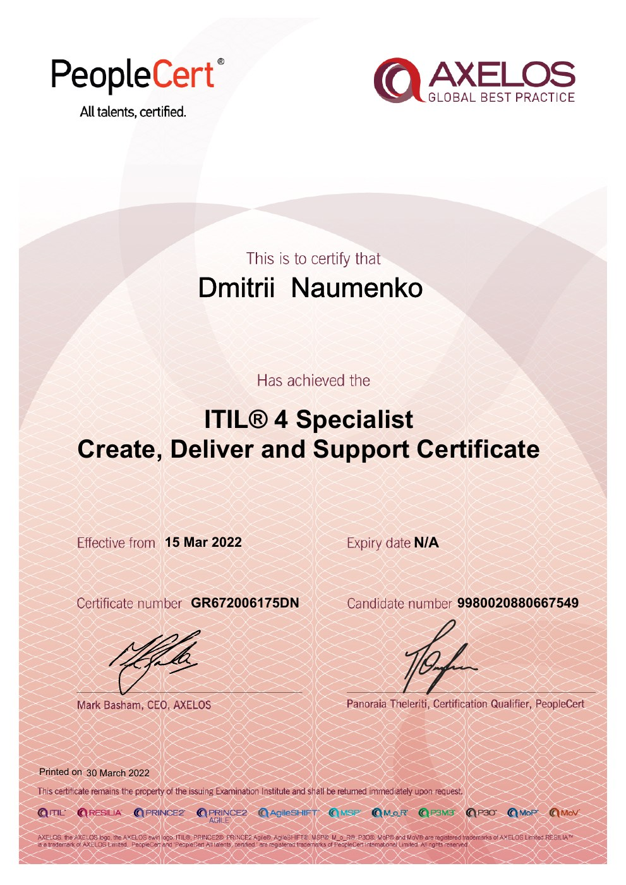](files/2022-itil-create-deliver-support.pdf)

### 2021 · ITIL Foundation

[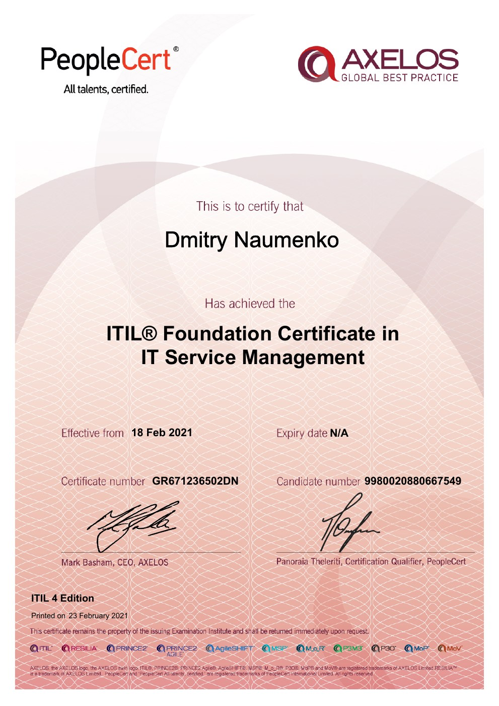](files/2021-itil-foundation.pdf)

