# Обучение, сертификации и экспертный опыт

For English, see [Credentials](README.en.md). · [Вернуться в портфолио](../README.md)

Подтверждения обучения и профессионального участия, от новых к более ранним. Превью открываются прямо в GitHub; оригиналы сохранены без изменений. Курсы, сертификации, финал соревнований и работа экспертом указаны раздельно.

| Год | Подтверждение | Основание | Организация / событие | Документы |
| --- | --- | --- | --- | --- |
| 2025 | **Project: Building Ambient Agents with LangGraph** | Завершение курса, 28 июля | LangChain Academy | [Превью](previews/2025-langgraph-ambient-agents.jpg) · [PDF](files/2025-langgraph-ambient-agents.pdf) |
| 2024 | **Принятие решений на основе данных. Data Science** | Завершение курса | karpov.courses | [Превью](previews/2024-data-driven-decisions.jpg) · [Оригинал JPG](files/2024-data-driven-decisions.jpg) |
| 2023 | **АтомикХак** | Эксперт хакатона | Корпоративная Академия Росатома | [Превью](previews/2023-atomichack-expert.jpg) · [PDF](files/2023-atomichack-expert.pdf) |
| 2023 | **Международный хакатон** | Эксперт хакатона | «Цифровой прорыв. Сезон: Искусственный интеллект» | [Превью](previews/2023-international-hackathon-expert.jpg) · [Оригинал PNG](files/2023-international-hackathon-expert.png) |
| 2023 | **Приём учётных документов** | Эксперт кейса | «Цифровой прорыв. Сезон: Искусственный интеллект» | [Превью](previews/2023-rzd-document-processing-expert.jpg) · [PDF](files/2023-rzd-document-processing-expert.pdf) |
| 2023 | **Безопасный маршрут** | Эксперт кейса | «Цифровой прорыв. Сезон: Искусственный интеллект» | [Превью](previews/2023-rzd-safe-route-expert.jpg) · [PDF](files/2023-rzd-safe-route-expert.pdf) |
| 2023 | **AI News** | **2-е место** | AI News | [Превью](previews/2023-ai-news-finalist.jpg) · [PDF](files/2023-ai-news-finalist.pdf) |
| 2023 | **Формирование графика движения судов** | Эксперт кейса | «Цифровой прорыв. Сезон: Искусственный интеллект» | [Превью](previews/2023-vessel-scheduling-expert.jpg) · [PDF](files/2023-vessel-scheduling-expert.pdf) |
| 2023 | **MTS Machine Learning Cup** | Участие, топ-50% лидерборда | МТС Digital / ODS | [Превью](previews/2023-mts-ml-cup-top-50-percent.jpg) · [PDF](files/2023-mts-ml-cup-top-50-percent.pdf) |
| 2023 | **Симулятор ML** | Практический курс; на сохранённом экране все группы задач выполнены на 100% | karpov.courses | [Превью](previews/2023-simulator-ml.jpg) · [Оригинал PNG](files/2023-simulator-ml.png) |
| 2022 | **Data Scientist** | Профессиональная программа, 400 часов | Practicum by Yandex | [Превью](previews/2022-yandex-data-scientist.jpg) · [PDF, 2 страницы](files/2022-yandex-data-scientist.pdf) |
| 2022 | **HackWagon'22** | Финалист | Первая грузовая компания | [Превью](previews/2022-hackwagon-finalist.jpg) · [PDF](files/2022-hackwagon-finalist.pdf) |
| 2022 | **Certified Administrator for Ivanti Service Manager** | Профессиональная сертификация | Ivanti | [Превью](previews/2022-ivanti-certified-administrator.jpg) · [PDF](files/2022-ivanti-certified-administrator.pdf) |
| 2022 | **ITIL 4 Specialist: Create, Deliver and Support** | Профессиональная сертификация | PeopleCert / AXELOS | [Превью](previews/2022-itil-create-deliver-support.jpg) · [PDF](files/2022-itil-create-deliver-support.pdf) |
| 2021 | **ITIL Foundation in IT Service Management, ITIL 4 Edition** | Профессиональная сертификация | PeopleCert / AXELOS | [Превью](previews/2021-itil-foundation.jpg) · [PDF](files/2021-itil-foundation.pdf) |

Сертификат LangChain Academy выдан на имя аккаунта **Dmitrii Home**. Результат AI News уточнён владельцем: 2-е место; сертификат оформлен как подтверждение финала. В строке Practicum показана вторая страница документа с именем, объёмом программы и результатами. Для Симулятора ML сохранён экран прогресса; он не обозначается как диплом.

Посмотреть превью документов

### 2025 · LangChain Academy

[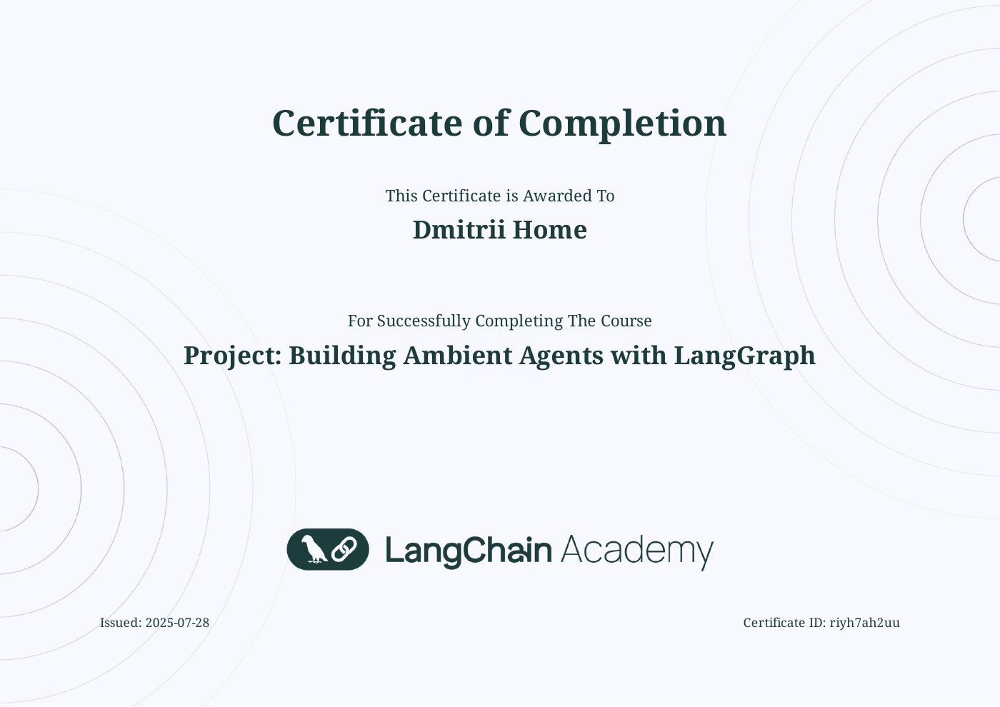](files/2025-langgraph-ambient-agents.pdf)

### 2024 · Принятие решений на основе данных

[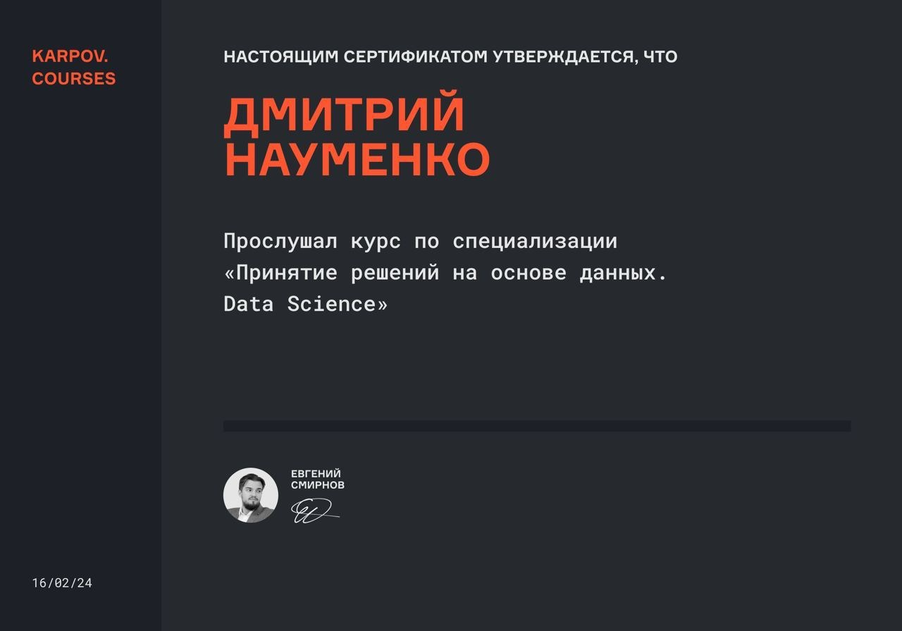](files/2024-data-driven-decisions.jpg)

### 2023 · Экспертное участие

[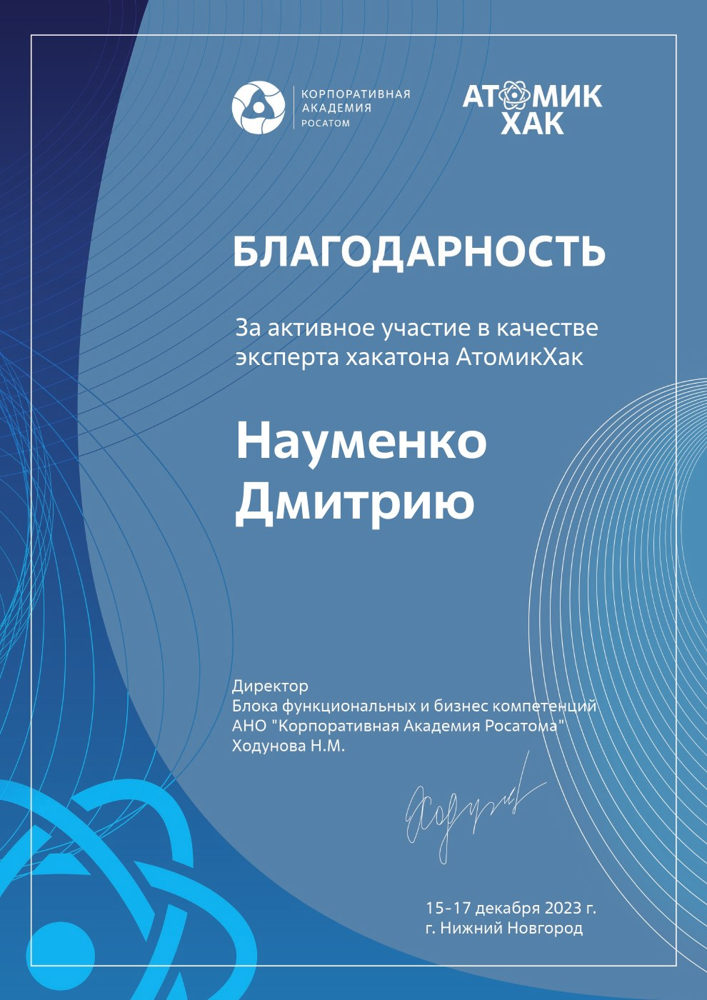](files/2023-atomichack-expert.pdf)

[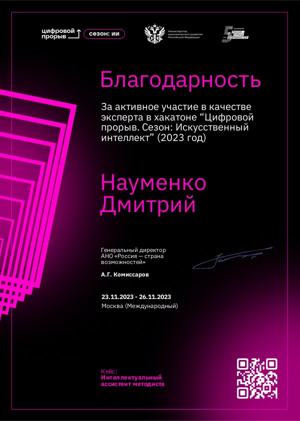](files/2023-international-hackathon-expert.png)

[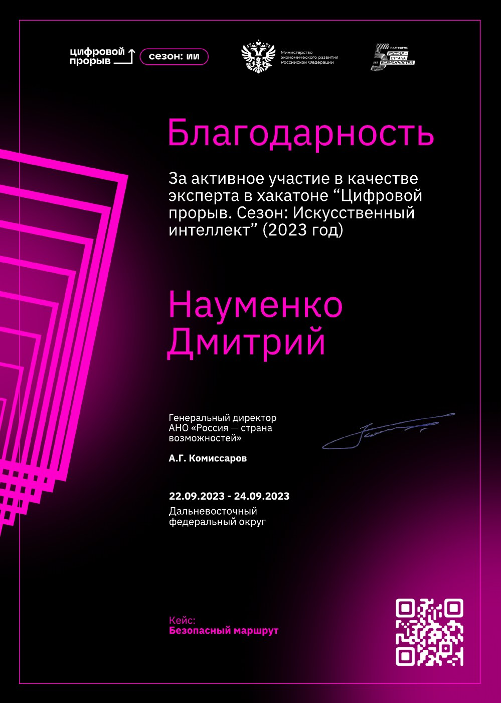](files/2023-rzd-safe-route-expert.pdf)

[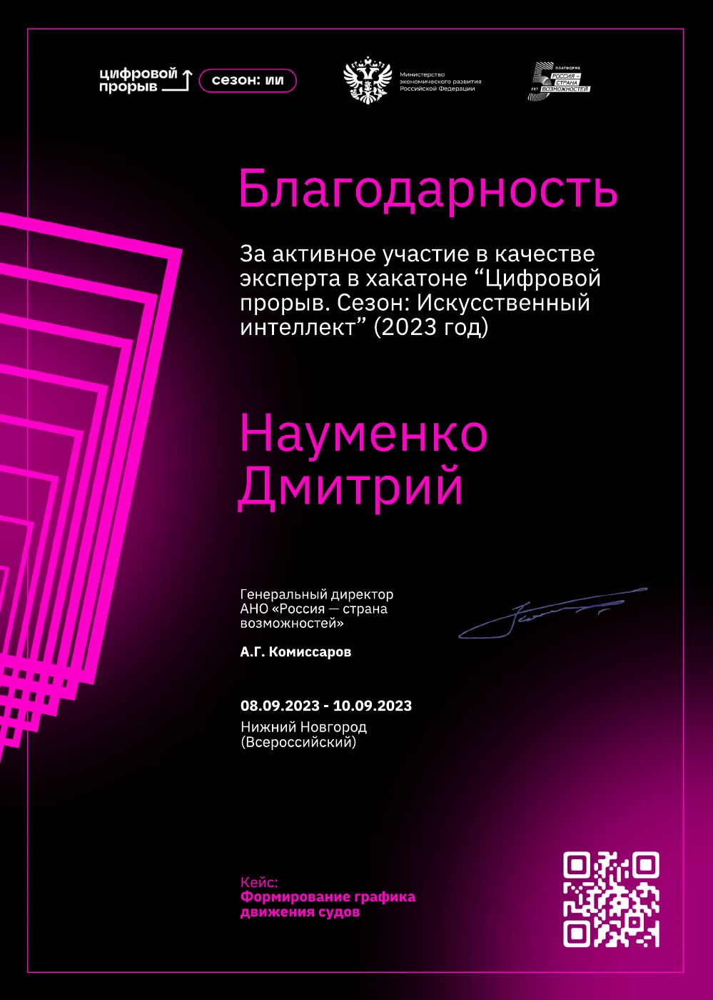](files/2023-vessel-scheduling-expert.pdf)

### 2023 · Соревнования и обучение

[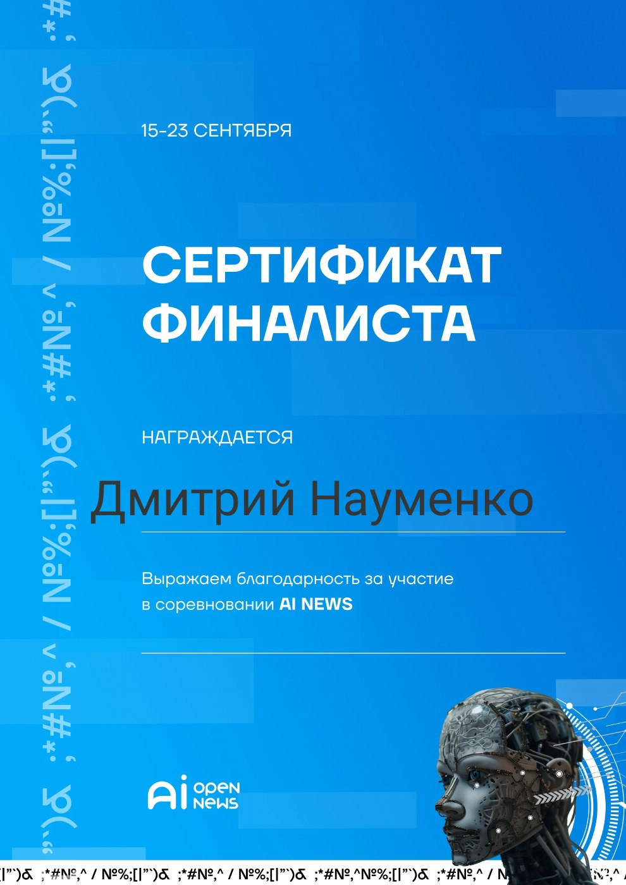](files/2023-ai-news-finalist.pdf)

[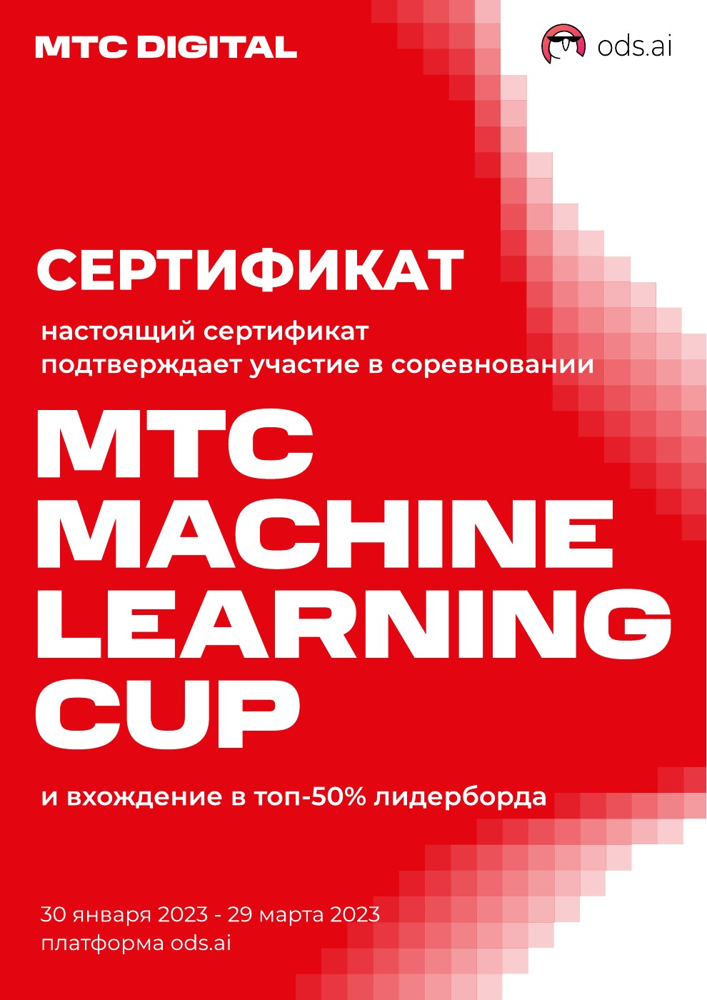](files/2023-mts-ml-cup-top-50-percent.pdf)

[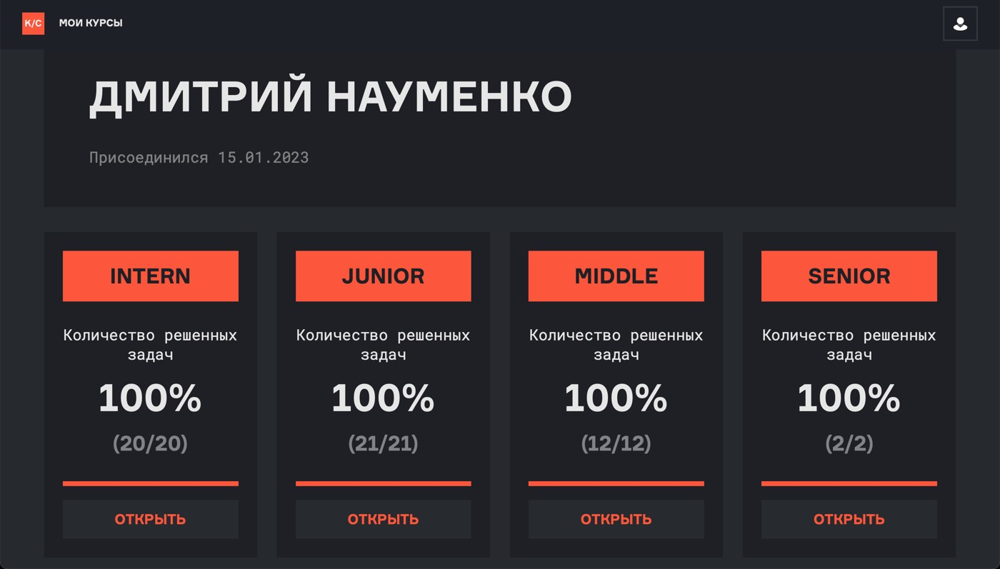](files/2023-simulator-ml.png)

### 2022 · Обучение, соревнования и сертификации

[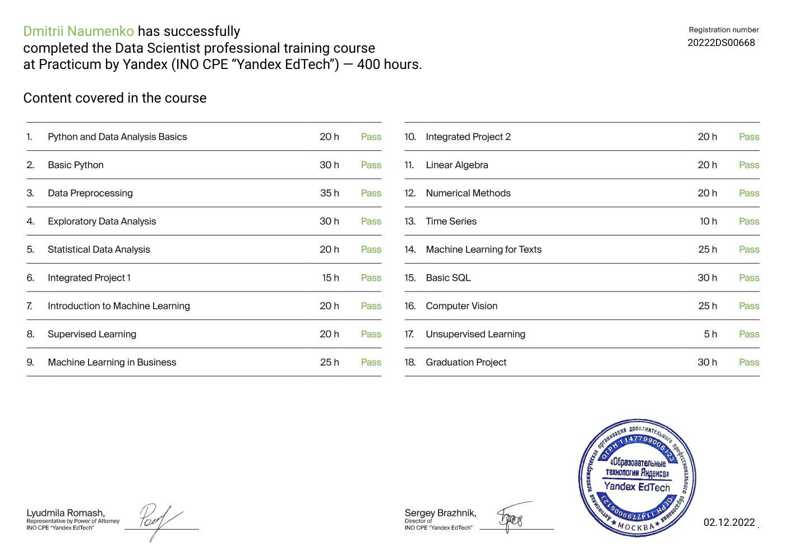](files/2022-yandex-data-scientist.pdf)

[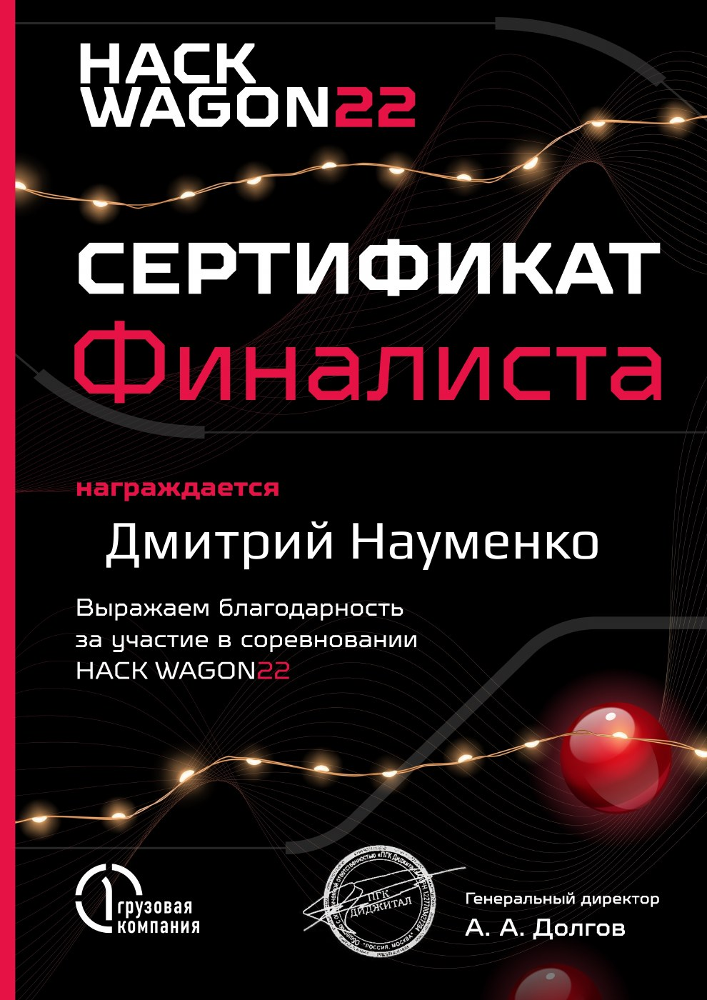](files/2022-hackwagon-finalist.pdf)

[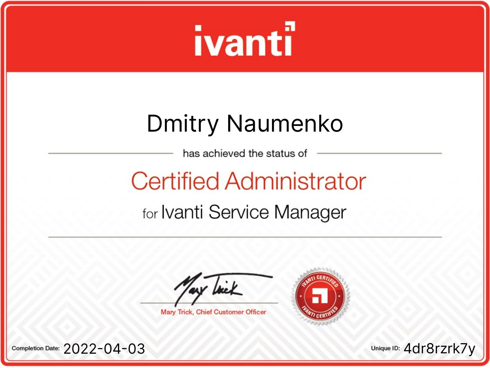](files/2022-ivanti-certified-administrator.pdf)

[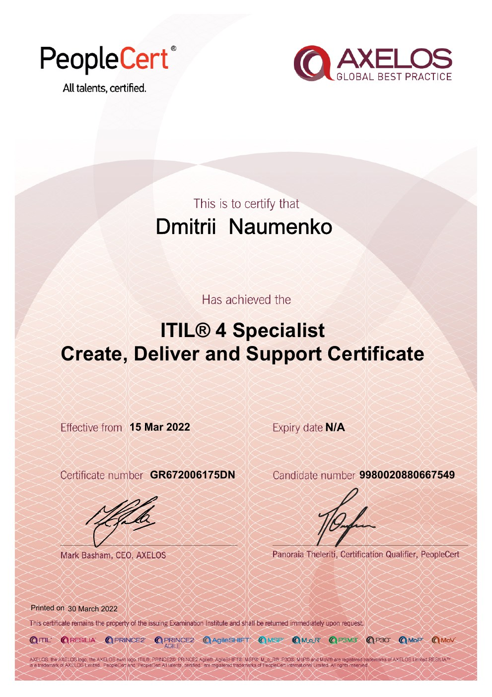](files/2022-itil-create-deliver-support.pdf)

### 2021 · ITIL Foundation

[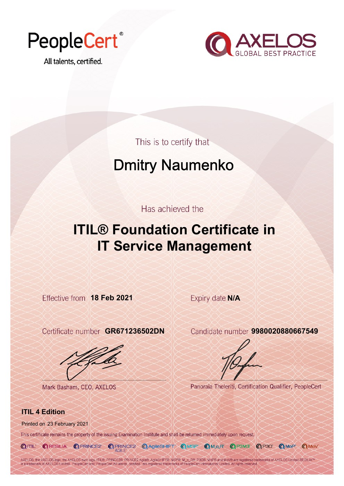](files/2021-itil-foundation.pdf)

