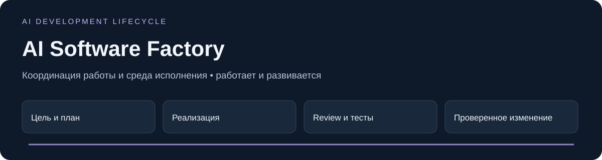
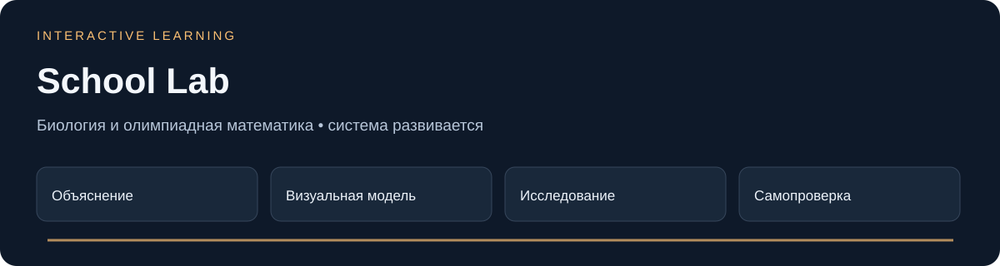

[Русская версия](../README.md)

# Dmitrii Naumenko
### Senior AI Engineer / AI Tech Lead

I design and build AI systems that connect data, tools, and domain knowledge to solve real problems. My focus spans the full path from a user need and system architecture to verification and continued product development.

[LinkedIn](https://www.linkedin.com/in/naumenko-d/) · [Telegram](https://t.me/naumenko_ds) · [Email](mailto:dima-post2009@yandex.com)

## Commercial work I can share publicly

A selection of projects from my commercial experience that I can demonstrate through public product pages and implementation stories.

Development of the **FinGPT** financial AI assistant and an **INNOMA** product, a warehouse Telegram bot at **Ultima BusinessWare**, and participation in an **Ivanti** implementation at Krasnodar Airport.

[Selected work and public sources](experience/README.md)

## Personal AI projects

[Explore projects and examples](https://dmitrii-naumenko.github.io/portfolio/)

### Autodiary
**A Personal AI Platform for Learning and Decision-Making · in use and evolving**

A personal AI platform for learning and decisions: an interactive knowledge library and trainers, a standalone English practice application, travel planning, personal consultations, news briefs, and research. These capabilities use accumulated context and feedback; life-metric analytics is one component.

**Engineering focus:** independent modules, relevant context through APIs/MCP and catalogs, traceable sources, interactive artifacts, and continuity across tasks.

[Read the case](../projects/autodiary/en/README.md) · [Explore an analytics example, in Russian](https://dmitrii-naumenko.github.io/portfolio/demos/autodiary.html)

### AI Software Factory
**Automating the Development Lifecycle · in use and evolving**

An AI software factory I am developing to coordinate planning, implementation, review, and verification. The factory manages work; an engineering harness provides the execution layer. It builds on my experience creating operational project-specific AI development workflows.

**Engineering focus:** coding-agent coordination, review and test feedback, repeatable checks, and developer control over consequential decisions.

[Read the case](projects/factory.md) · [How the factory works, in Russian](https://dmitrii-naumenko.github.io/portfolio/demos/factory.html)

### School Lab
**From Textbooks to Interactive Learning · biology and olympiad-style mathematics**

A substantial, evolving system covering biology and olympiad-style mathematics through courses, lessons, and modules with explanations, visual models, and self-checks. The mathematics direction is developing as a lesson series. The public fractions lab is one selected example; completed pages work offline.

**Engineering focus:** AI-assisted content preparation, independent source review, a shared lesson structure, reusable templates, and automated validation.

[Read the case](projects/school.md) · [Try the fractions lab, in Russian](https://dmitrii-naumenko.github.io/portfolio/demos/school.html)

## Certificates and architecture work

**[Certificates, learning, and expert roles](../credentials/README.en.md)**

- [ML System Design Challenge 2023](experience/system-design.md): my bank anti-fraud system design, with a design document and presentation.
- **AI News 2023: second place at the hackathon.**

The Autodiary analytics example uses synthetic data. The public School Lab lesson presents one part of an evolving learning system. Example interfaces are in Russian.
