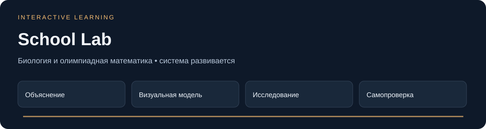

[Portfolio](../README.md) · [Русский](../../projects/school.md)

# School Lab — From Textbooks to Interactive Learning

**A substantial, evolving interactive learning system, currently covering biology and olympiad-style mathematics.**

[Open one sample lesson: the fractions lab, in Russian](https://dmitrii-naumenko.github.io/portfolio/demos/school.html). Explore fraction models, equivalent fractions, and the practice section. This is one selected learning example from the mathematics direction.

## Purpose and my contribution

I am developing School Lab to turn learning materials into clear, engaging lessons that help people understand a topic, explore its underlying ideas, and put their knowledge into practice. Each lesson combines explanations, visual models, interactive activities, and self-check questions, with concise reference material available when needed.

The content workflow combines PDF and OCR extraction, AI-assisted authoring, independent review against the source, and automated validation. A shared content structure and reusable templates support growing courses, adding lessons, and extending the approach to new subjects. Completed lessons work offline, with no installation or account required.

## Two growing learning areas

**Biology.** A structured course combining explanations, illustrations, interactive models, self-checks, and homework. It includes 27 sections and 19 short project reports. This direction uses PDF/OCR extraction, structured lesson data, independent source review, templates, validation, and standalone HTML generation.

**Olympiad-style mathematics.** This direction is developing as a series of lessons and modules, moving from visual understanding to reasoning, patterns, and transfer problems. The public fractions lab is one sample lesson. The series is expanding with new topics and modules; the portfolio presents a selected part of the system.

## Engineering decisions

- Separate content from presentation to support consistent updates and library growth.
- Complement structural validation with independent review against the source.
- Connect explanation, exploration, and self-checks so a learner can apply an idea immediately.
- Deliver standalone HTML lessons that remain available offline without a server, installation, or account.

## How the system grows

New material extends a course or a standalone module. Shared templates provide a consistent interface; source review checks meaning and exercises, while automated validation checks structure and assembly. Browser verification covers visual models, self-checks, and narrow screens.

The fractions lab was integrated as a completed authored artifact. It shows the interactive outcome of the mathematics direction; the biology course separately demonstrates textbook processing and the assembly of a lesson series.
