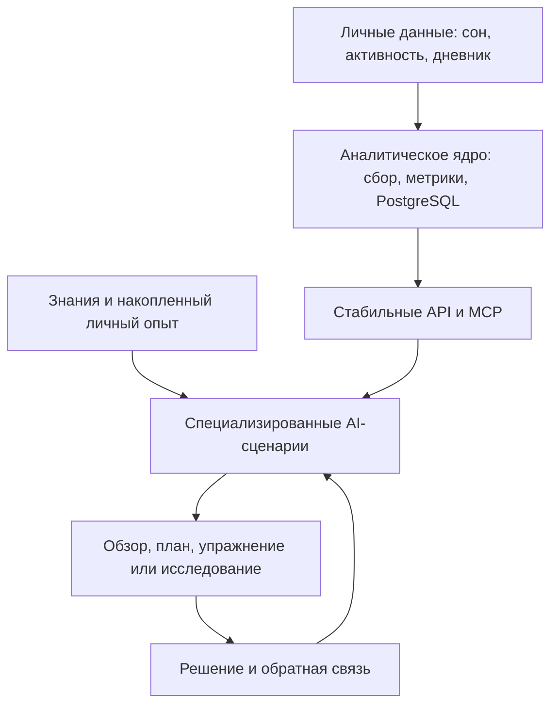

For English, see the [English version](en/README.md).

# Autodiary — персональная AI-платформа для обучения и принятия решений

Я создал Autodiary, чтобы использовать собственный опыт в следующих решениях. Проект начался с анализа здоровья и активности. Сегодня он связывает то, что я отслеживаю, изучаю и уже пробовал: полезное наблюдение в одной области жизни помогает разобраться с вопросом в другой.

**[Посмотреть демонстрационный сценарий](https://dmitrii-naumenko.github.io/portfolio/demos/autodiary.html)** · **[Портфолио автора](https://github.com/dmitrii-naumenko/portfolio)** · **[Методология](docs/methodology.md)**

*Скриншот аналитического ядра из раннего среза проекта. Публичные изображения ниже показывают отдельные компоненты; они не отражают текущие личные данные.*

## Один сценарий связывает систему

Семейная поездка показывает, как части работают вместе. План следующего путешествия учитывает прошлые маршруты, то, что понравилось каждому, и то, что хочется изменить. При ежемесячном обзоре эта же поездка помогает понять контекст изменений сна или тренировок. Наблюдение получает объяснение и становится основой следующего решения.

Тот же принцип работает в обучении: книги превращаются в интерактивные упражнения, практика английского опирается на предыдущие занятия, а вопрос из личного дневника проходит путь через исследование и редактирование до публикации с обратной связью.

| Задача | Что получает пользователь |
|---|---|
| Разобраться в изменении самочувствия или нагрузки | Связанный обзор сна, активности, тренировок и дневника с источниками и ограничениями вывода |
| Подготовить следующую поездку | План с учётом истории семьи, предпочтений и уроков прошлых путешествий |
| Применить прочитанное | Интерактивный материал и упражнения, которые помогают перейти от идеи к практике |
| Продолжить изучение английского | Практику, связанную с предыдущими занятиями и материалом для повторения |
| Развить личное наблюдение | Исследование и публикацию, после которых обратная связь помогает выбрать следующий шаг |

## Инженерная основа

Главное архитектурное решение — дать каждому модулю владение своими данными и обеспечить доступ к релевантным свидетельствам между модулями. Аналитическое ядро на Python и PostgreSQL рассчитывает **200+ версионируемых метрик**. Специализированные агенты получают нужный контекст через стабильные API, Model Context Protocol (MCP) и поисковые каталоги.

- **Воспроизводимые расчёты.** Метрика хранится вместе с версией методологии и статусом расчёта; изменения формул позволяют обнаружить устаревшие значения и пересчитать историю.
- **Единый контракт доступа.** Данные доступны аналитике, AI-инструментам и Grafana через согласованные интерфейсы. MCP отделяет контракт инструментов от выбора модели.
- **Прослеживаемость.** Вывод можно связать с исходными наблюдениями. Новые свидетельства позволяют вернуться к прежнему заключению и уточнить его.
- **Преемственность решений.** Следующая рекомендация учитывает прошлые попытки, ограничения и обратную связь пользователя.

**Основной стек:** Python · PostgreSQL + pgvector · FastAPI · Pydantic · Alembic · FastMCP · Docker Compose · Grafana. Разработка и AI-сценарии используют Claude Code и Codex.

## Проверка и границы выводов

Качество складывается из проверки расчётов, статусов и полноты данных, а также проверки того, чем обоснован аналитический вывод. Незавершённый период отличается от полного, пропуск наблюдения — от нулевого значения, а гипотеза — от подтверждённого факта. Идеи из книг помогают интерпретации и практике, но не заменяют личные наблюдения и не доказывают причинность.

Система используется для личной аналитики, обучения и планирования. Это индивидуальный проект; измеренное улучшение здоровья, продуктивности или обучения здесь не заявляется. Обсуждение здоровья не заменяет медицинскую помощь.

## Материалы для просмотра

| Аналитика и накопление выводов | Разговор с данными через MCP |
|:--:|:--:|
|  |  |

| Пример подключения MCP | Интерактивное знание: UI-концепт |
|:--:|:--:|
|  |  |

*Скриншоты относятся к предыдущим срезам продукта. Изображение интерактивного знания — синтетический UI-концепт, а не снимок текущего приложения.*

- [Демонстрация: от наблюдения к решению](https://dmitrii-naumenko.github.io/portfolio/demos/autodiary.html) — отобранный пример на демонстрационных данных.
- [Видение продукта и сценарии](docs/vision.md).
- [Методология: расчёты, свидетельства и обратная связь](docs/methodology.md).
- [Продуктовая презентация, март 2026 (PDF)](presentation/autodiary_product.pdf) — исторический срез аналитического ядра; не описание полного текущего продукта.

## Статус

Autodiary — работающая персональная система, которая продолжает развиваться. Срез витрины: **ноябрь 2026**. Аналитика, знания, путешествия, практика английского и исследовательские сценарии представлены как используемые части системы; это не публичный многопользовательский сервис.

Кейс входит в [портфолио автора](https://github.com/dmitrii-naumenko/portfolio) и объединяет описание, выбранные изображения и демонстрацию. Пример использует демонстрационные данные; внутреннее устройство новых сценариев здесь не раскрывается.

**Дмитрий Науменко** · [LinkedIn](https://www.linkedin.com/in/naumenko-d/) · [Telegram](https://t.me/naumenko_ds) · [Email](mailto:dima-post2009@yandex.com)
