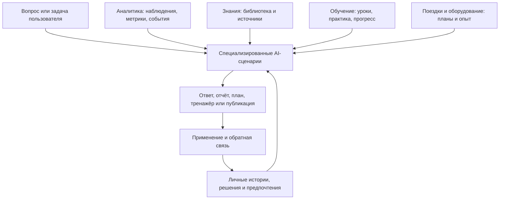
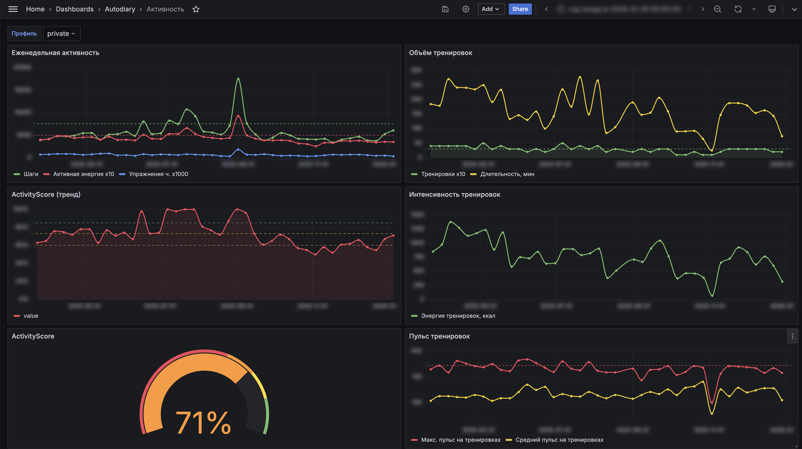
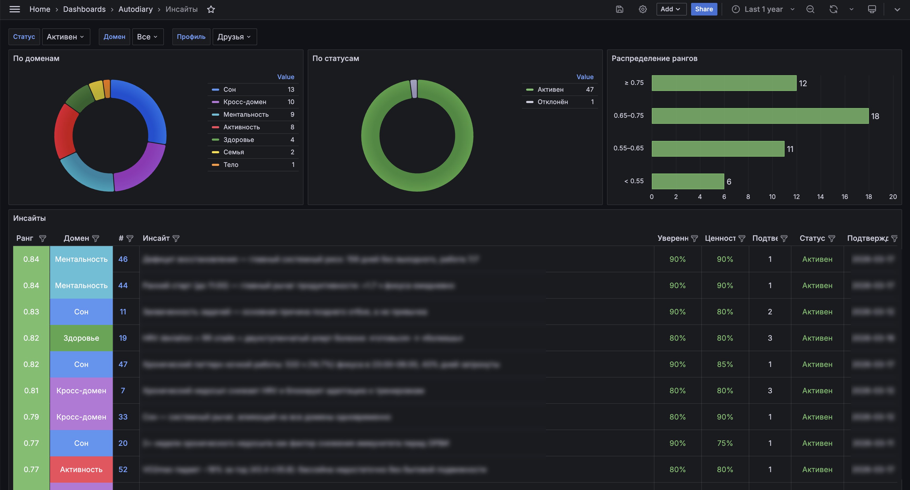
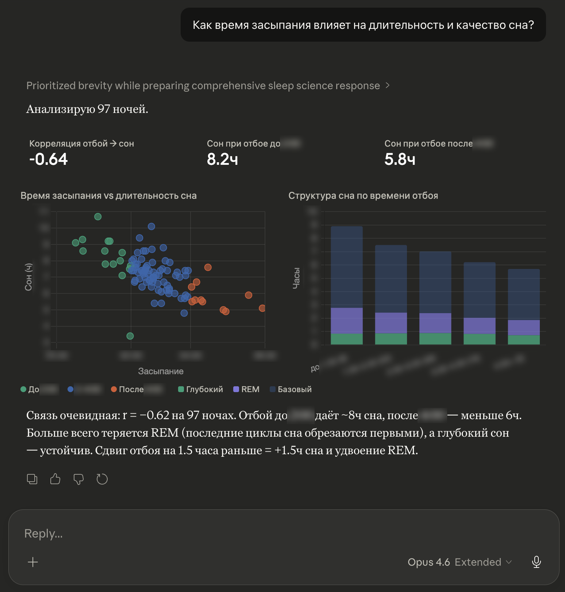
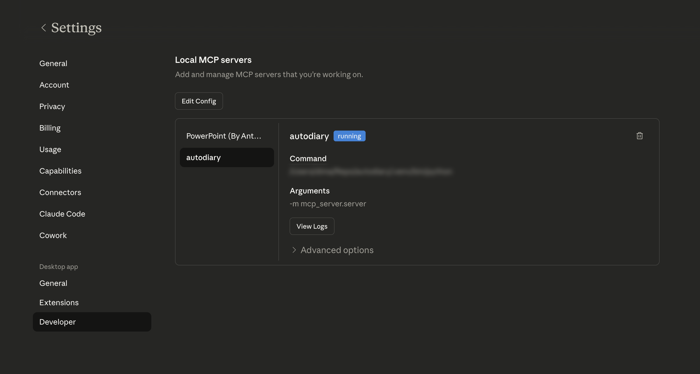
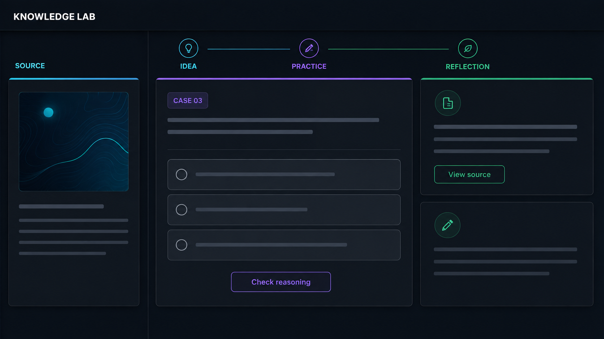

For English, see the [English version](en/README.md).

# Autodiary — персональная AI-платформа для обучения и принятия решений

Я развиваю Autodiary, чтобы использовать свои данные, знания и накопленный опыт в повседневных задачах. Система помогает разобраться в происходящем, освоить материал, спланировать действие и вернуться к результату позже. В ней связаны библиотека знаний и тренажёры, английская практика, путешествия и оборудование, личные консультации, исследования и аналитика.

Проект начался с анализа здоровья и активности. Сегодня аналитическое ядро — один из самостоятельных компонентов платформы. Другие модули имеют собственные данные, инструменты и пользовательские артефакты: от интерактивного урока до плана поездки или тренировочной программы.

**Работает и развивается.** [Портфолио автора](https://github.com/dmitrii-naumenko/portfolio) · [Связи между модулями](docs/vision.md) · [Пример аналитического сценария](https://dmitrii-naumenko.github.io/portfolio/demos/autodiary.html)

## Что можно сделать с Autodiary

| Задача | Конкретный результат |
|---|---|
| **Понять и применить книгу, документ или видео** | Интерактивный материал с картой идей и переходами к источнику; отдельный тренажёр с ситуационными кейсами, объяснениями и заданиями для применения в жизни |
| **Продолжать изучение английского** | Локальное приложение с учебными картами, интерактивными уроками, словарём, аудио и интервальным повторением. AI-coach связывает разговорную и письменную практику с историей занятий и повторяющимися трудностями |
| **Подготовить семейную поездку** | План с маршрутами, вариантами по погоде и нагрузке, подготовкой и снаряжением; удобная HTML-версия. Следующий план учитывает впечатления участников и уроки прежних поездок |
| **Разобраться в здоровье, тренировках или питании** | История медицинского вопроса и вопросы к врачу, план чекапов, разбор питания по фото и этикеткам, следующая тренировка и обновляемые карточки программы — с учётом доступных данных и личного контекста |
| **Продолжить важный личный или профессиональный вопрос** | Сохранённая предыстория разговора, его фактический итог и следующий шаг; прежние поправки и решения учитываются при возвращении к теме |
| **Выбрать подходящий вариант для себя** | Рекомендация фильма, книги, оборудования или формата совместного времени, которая учитывает предпочтения, прежние решения и новый отклик |
| **Понять, что происходило за неделю или месяц** | Связный обзор сна, активности, тренировок, дневника и событий; существенные изменения, ограничения выводов и следующие проверяемые шаги |
| **Сохранять информационный фокус** | Персональный обзор важных AI-новостей и инструментов с объяснением значимости; выбранную тему можно изучить глубже, а обратную связь учесть в следующем выпуске |
| **Развить личный вопрос в исследование** | Материал, прошедший исследование, редактирование и проверку, с иллюстрацией и публикацией в Telegram. Реакции и комментарии помогают выбрать дальнейшее направление |

## Почему это одна платформа

**Знание продолжается в практике.** Книга или публичное видео становятся материалом, к которому удобно возвращаться. На его основе можно отработать решения в тренажёре. Позже релевантная идея из библиотеки помогает разобрать новый личный вопрос — с возможностью вернуться к исходному фрагменту. Авторская идея и результат её применения остаются разными видами свидетельств.

**Поездка продолжается в следующем решении.** Её план учитывает прошлые маршруты, предпочтения семьи и опыт использования оборудования. После возвращения сохраняется то, что действительно произошло и понравилось. Эти сведения полезны и для следующего путешествия, и для понимания изменений сна или нагрузки в обзоре месяца.

**Обучение продолжается между занятиями.** Встреченное слово попадает в словарь и повторение. Письменная попытка и разговорная практика дают материал для разбора; повторяющаяся трудность становится основанием следующего упражнения. Исправление после подсказки отличается от самостоятельного применения в новой ситуации.

Связующим элементом служит накопленный контекст: источники, личная история, прошлые попытки, принятые решения и обратная связь. Пользователь получает результат в подходящей форме — ответ, отчёт, план, интерактивное занятие, PDF-карточку или публикацию.

## Мой инженерный вклад

Я спроектировал и развиваю систему как набор связанных модулей с понятными границами ответственности.

- **Владение данными в модулях.** Аналитическое ядро, библиотека, путешествия и английский имеют собственные жизненные циклы. Релевантный контекст доступен другим задачам через стабильные API, MCP и каталоги. English Practice работает самостоятельно, без запуска ядра метрик и его БД.
- **Разделение работы AI и программного кода.** AI помогает исследовать, объяснять и готовить содержание; расчёты, проверки структуры, сборка и сохранение результатов опираются на программные инструменты. Подготовленные интерактивные материалы и тренажёры могут работать офлайн без модели.
- **Проверяемое основание результата.** Вывод связан с наблюдением или документом, идея — с источником, учебная попытка — с фактическим ответом. При появлении новых данных можно вернуться к прежнему заключению.
- **Преемственность и обратная связь.** Система различает предложенное, принятое, применённое и отклонённое. Следующий запрос использует релевантный опыт, сохраняя особенности каждой области.

**Техническая основа:** Python · PostgreSQL + pgvector · SQLite · FastAPI · MCP · автономные HTML/CSS/JS-артефакты · Docker Compose · Grafana. AI-разработка и пользовательские workflows используют Codex и Claude Code.

Аналитическое ядро рассчитывает **200+ версионируемых метрик**. Его собственные правила качества данных, периодов и пересчёта описаны в [методологии аналитического ядра](docs/methodology.md).

## Что можно посмотреть публично

- [От наблюдения к решению](https://dmitrii-naumenko.github.io/portfolio/demos/autodiary.html) — интерактивный пример **одного аналитического сценария** на синтетических данных.
- [Видение платформы и связи модулей](docs/vision.md).
- [Методология аналитического ядра](docs/methodology.md).

Исторические изображения компонентов и презентация

| Аналитика и накопленные выводы | Вопрос по данным через MCP |
|:--:|:--:|
|  |  |

| Пример подключения MCP | Интерактивное знание: UI-концепт |
|:--:|:--:|
|  |  |

Изображения относятся к предыдущим срезам отдельных компонентов. Изображение интерактивного знания — синтетический UI-концепт. [Презентация марта 2026 (PDF)](presentation/autodiary_product.pdf) показывает ранний аналитический срез проекта.

## Текущее состояние

Autodiary используется как развивающаяся персональная система. Работа идёт через AI-ассистента, специализированные workflows и отдельные локальные инструменты; результаты сохраняются и используются в следующих задачах. Это авторский проект для собственного применения, а не заявка на готовый массовый сервис. Измеренное улучшение здоровья или обучения здесь не заявляется; работа с медицинскими данными помогает подготовить вопросы к врачу.

**Дмитрий Науменко** · [LinkedIn](https://www.linkedin.com/in/naumenko-d/) · [Telegram](https://t.me/naumenko_ds) · [Email](mailto:dima-post2009@yandex.com)
