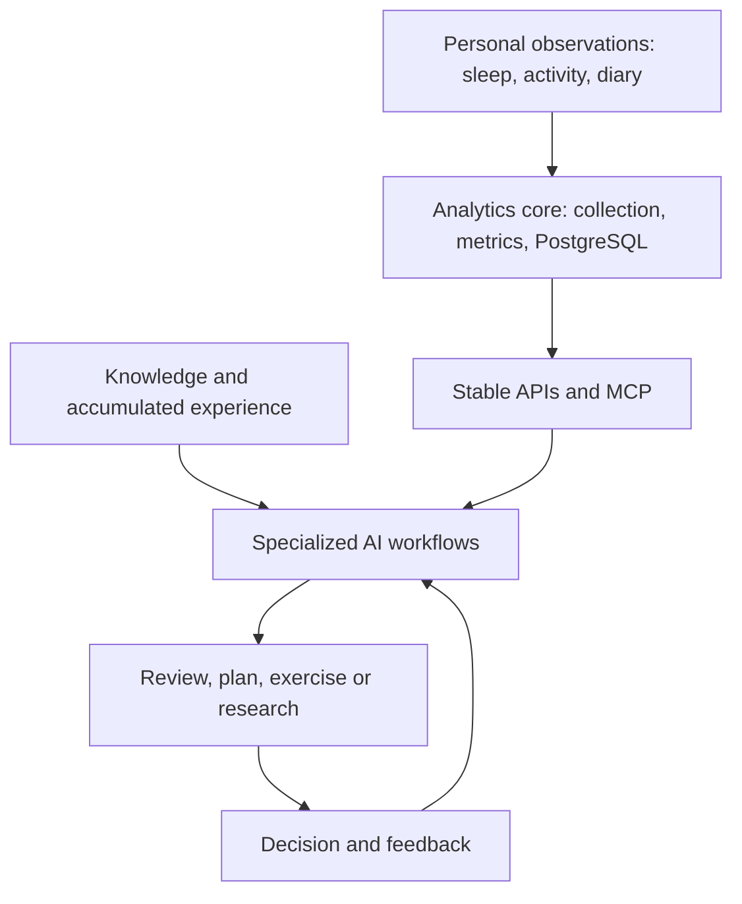
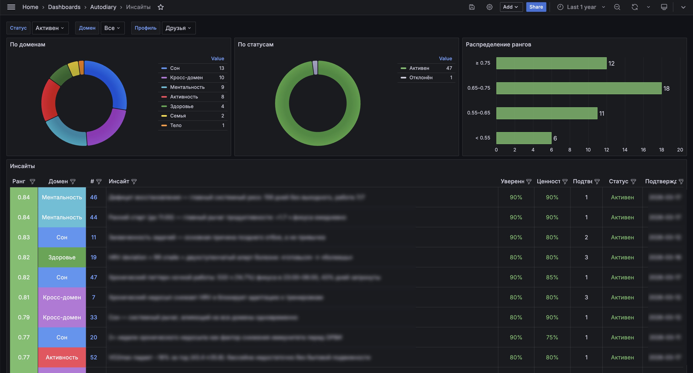
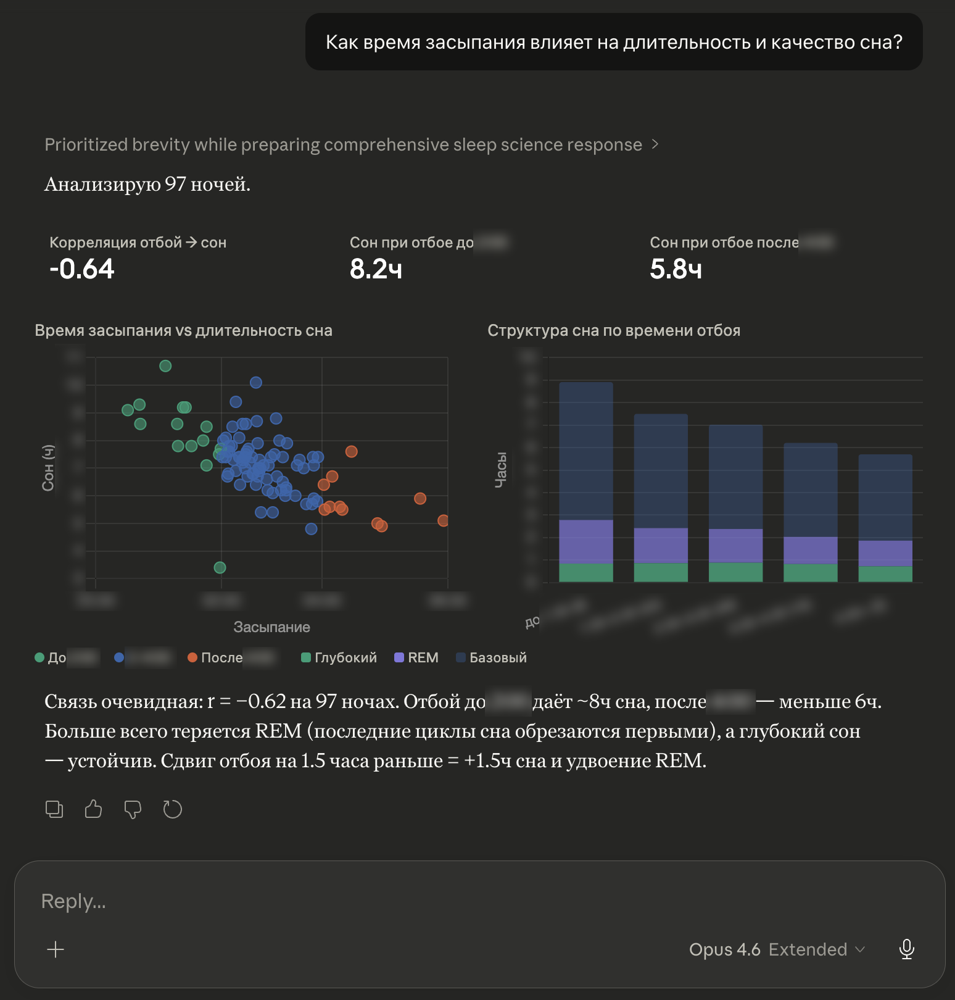
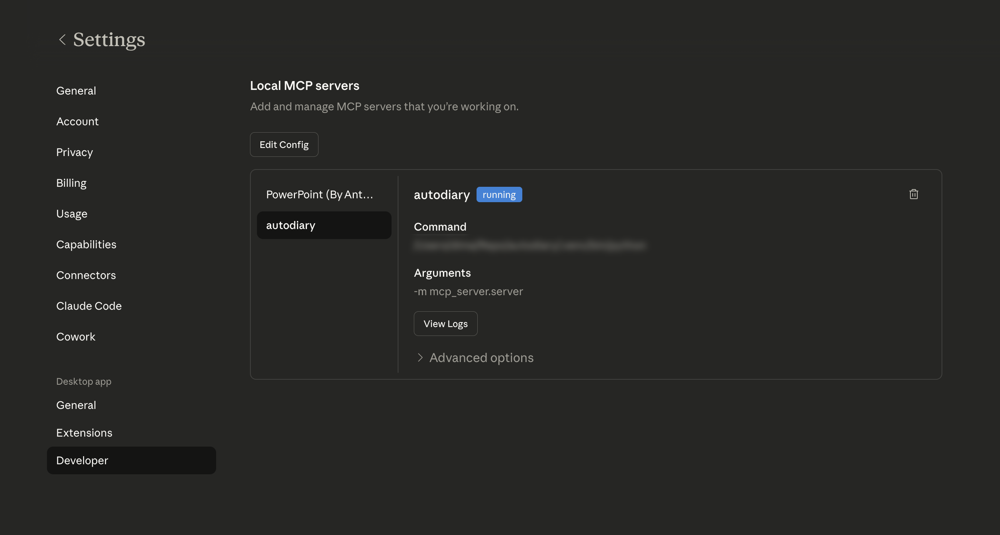
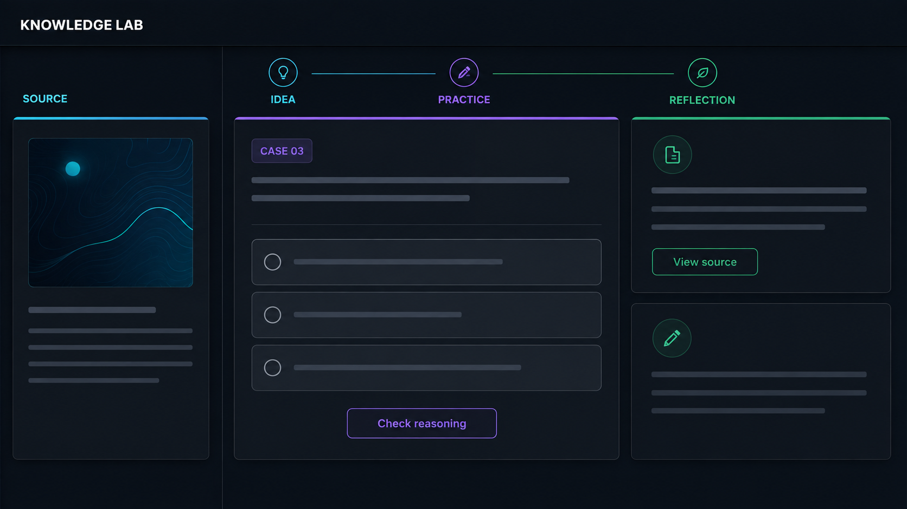

[Русская версия](../README.md)

# Autodiary — A Personal AI Platform for Learning and Decision-Making

I built Autodiary to put my own experience to use. It began as a way to make sense of personal health and activity data. Today it connects what I track, what I learn, and what I’ve already tried, so that a useful observation in one part of my life can inform a decision somewhere else.

A family trip shows how the pieces fit together. When I plan the next one, Autodiary draws on past itineraries, what each person enjoyed, and what we’d change. That same trip gives a monthly review context for a shift in sleep or training. The platform also turns books into interactive exercises, builds English practice around earlier lessons, and takes a question from my journal through research, editing, and publication.

The central engineering decision was to give each module ownership of its data and make the relevant evidence accessible across modules. A Python and PostgreSQL analytics core tracks 200+ versioned metrics. Specialized agents use stable APIs, Model Context Protocol (MCP) tools, and searchable catalogs to retrieve the context each task needs. They can trace findings back to their sources, revisit earlier conclusions when new evidence appears, and carry my feedback into the next recommendation.

**[Explore a demonstration](https://dmitrii-naumenko.github.io/portfolio/demos/autodiary.html)** · **[Author’s portfolio](https://github.com/dmitrii-naumenko/portfolio/tree/main/en)** · **[Analytics core methodology](methodology.md)**

*An earlier view of the analytics core. Public images below show selected components, not current personal data.*

## What the system delivers

| Task | Result |
|---|---|
| Understand a change in wellbeing or training load | A connected view of sleep, activity, training and diary observations, with supporting sources and limits |
| Plan another trip | An itinerary informed by the family’s preferences and lessons from previous trips |
| Apply what I read | Interactive learning materials and exercises that connect an idea to practice |
| Continue English practice | Sessions that build on earlier lessons and material to revisit |
| Develop a personal observation | Research and publication followed by feedback that informs the next step |

## Engineering choices

- **Reproducible calculations.** Values carry a methodology version and calculation status. Changes make outdated results detectable and historical recalculation possible.
- **Stable access contracts.** Analytics, AI tools and Grafana consume defined interfaces. MCP separates the tool contract from the choice of model.
- **Traceable findings.** Conclusions can be connected to observations and revisited when new evidence appears.
- **Continuity.** Recommendations take earlier attempts, constraints and the owner’s feedback into account.

**Core stack:** Python · PostgreSQL + pgvector · FastAPI · Pydantic · Alembic · FastMCP · Docker Compose · Grafana. Development and AI workflows use Claude Code and Codex.

## Verification and limits

Calculation checks, data quality and analytical reasoning address different questions. An incomplete period differs from a complete one; a missing observation differs from zero; a hypothesis differs from an established fact. Ideas from books support interpretation and practice, but do not replace personal evidence or establish causality.

This is an individual system used for personal analytics, learning and planning. No measured improvement in health, productivity or learning is claimed here. Health discussions do not replace medical care.

## Selected materials

| Analytics and accumulated findings | Asking a question through MCP |
|:--:|:--:|
|  |  |

| Example MCP connection | Interactive knowledge: UI concept |
|:--:|:--:|
|  |  |

*Screenshots come from earlier versions. The interactive knowledge image is a synthetic UI concept, not a screenshot of the current application.*

- [Demonstration: from an observation to a decision](https://dmitrii-naumenko.github.io/portfolio/demos/autodiary.html), using illustrative data. The demonstration interface is in Russian.
- [Product vision](vision.md).
- [Analytics core methodology](methodology.md).
- [Product presentation, March 2026 (PDF, Russian)](../presentation/autodiary_product.pdf), a historical view of the analytics core rather than a description of the full current product.

## Status

Autodiary is a working personal system that continues to evolve. This showcase reflects **November 2026**. Analytics, knowledge, travel, English practice and research are used parts of that system; it is not a public multi-user service.

This case is part of the [author’s portfolio](https://github.com/dmitrii-naumenko/portfolio/tree/main/en), bringing together the description, selected images and a demonstration. The example uses illustrative data; internal implementation details of newer workflows are not published here.

**Dmitrii Naumenko** · [LinkedIn](https://www.linkedin.com/in/naumenko-d/) · [Telegram](https://t.me/naumenko_ds) · [Email](mailto:dima-post2009@yandex.com)
