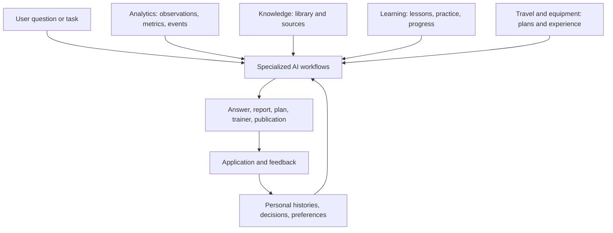
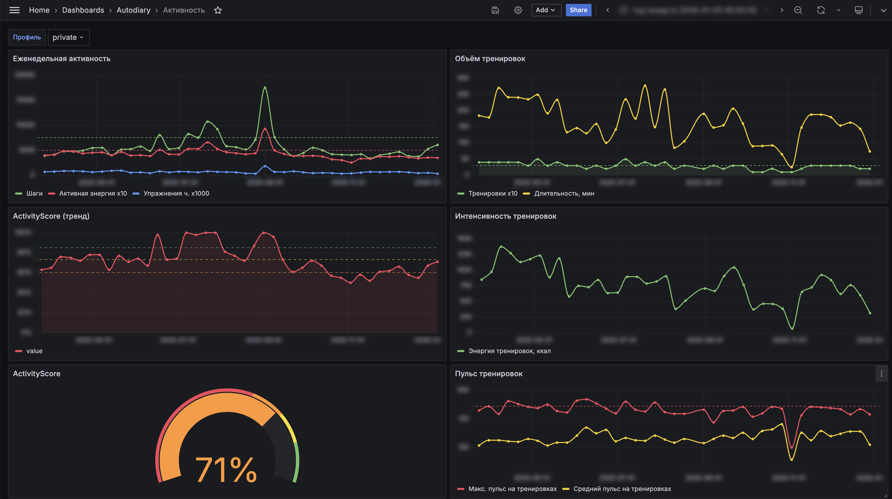

[Русская версия](../README.md)

# Autodiary — A Personal AI Platform for Learning and Decision-Making

I am developing Autodiary to put my data, knowledge, and accumulated experience to use in everyday tasks. It helps me understand what is happening, learn a topic, plan an action, and return to the outcome later. It connects a knowledge library and practice trainers, English learning, travel and equipment, personal consultations, research, and analytics.

The project began with health and activity data. Today the analytics core is one of several independent components. Other modules own their data, tools, and user-facing artifacts, from an interactive lesson to a travel plan or training programme.

**In use and evolving.** [Author’s portfolio](https://github.com/dmitrii-naumenko/portfolio/tree/main/en) · [How the modules connect](vision.md) · [An analytics example, in Russian](https://dmitrii-naumenko.github.io/portfolio/demos/autodiary.html)

## What the platform delivers

| Task | Concrete result |
|---|---|
| **Understand and apply a book, document, or video** | Interactive material with an idea map and source references; a separate trainer with situational cases, explanations, and exercises for real-life application |
| **Continue learning English** | A local application with learning maps, interactive lessons, vocabulary, audio, and spaced review. An AI coach connects speaking and writing practice with lesson history and recurring difficulties |
| **Plan a family trip** | An itinerary with alternatives for weather and physical load, preparation, equipment, and a mobile-friendly HTML version. Future plans incorporate participants’ impressions and lessons from previous trips |
| **Explore health, training, or nutrition questions** | A source-linked medical history and questions for a clinician, a checkup plan, a food review from photos and labels, or the next workout and updated programme cards, informed by available evidence and personal context |
| **Choose something that fits my preferences** | A film, book, equipment choice, or shared activity informed by earlier decisions, preferences, and new feedback |
| **Make sense of a week or month** | A connected review of sleep, activity, workouts, diary entries, and events, with meaningful changes, limits, and next steps that can be checked |
| **Maintain information focus** | A personal brief of significant AI and developer-tool news, with explanations of relevance, deeper follow-up on selected topics, and feedback informing subsequent briefs |
| **Develop a personal question into research** | A researched, edited, and checked article with an illustration and Telegram publication; reactions and comments inform the next direction |

## Why these are parts of one platform

**Knowledge continues into practice.** A book or public video becomes material that is easy to revisit. Its ideas can be practised in a trainer. Later, a relevant idea from the library can inform a new personal question, with a route back to the source. An author’s idea remains distinct from evidence of its effect in my life.

**A trip informs the next decision.** Planning draws on previous itineraries, family preferences, and equipment experience. After returning, the system retains what actually happened and what people enjoyed. This supports both the next trip and the interpretation of sleep or activity changes in a monthly review.

**Learning continues between sessions.** An encountered word becomes vocabulary and review material. Writing attempts and speaking practice provide evidence for feedback; a recurring difficulty can inform a new exercise. A correction made with hints remains distinct from independent use in a new situation.

The common thread is accumulated context: sources, personal history, earlier attempts, decisions, and feedback. Results take the form that fits the task: an answer, report, plan, interactive lesson, PDF card, or publication.

## My engineering contribution

I designed and continue to develop a system of connected modules with clear responsibilities.

- **Module-owned data.** Analytics, the library, travel, and English learning have their own lifecycles. Stable APIs, MCP tools, and catalogs make relevant context accessible across tasks. English Practice runs independently of the metrics core and its database.
- **Explicit roles for AI and code.** AI supports research, explanation, and authoring; calculations, structural checks, assembly, and persistence rely on software tools. Prepared interactive materials and trainers can work offline without a model.
- **Traceable results.** Findings connect to observations or records, ideas to sources, and learning evidence to actual attempts. New evidence can prompt a return to an earlier conclusion.
- **Continuity and feedback.** The system distinguishes a proposal, acceptance, application, and rejection. Subsequent tasks use relevant experience while preserving each domain’s own meaning.

**Technical foundation:** Python · PostgreSQL + pgvector · SQLite · FastAPI · MCP · standalone HTML/CSS/JS artifacts · Docker Compose · Grafana. Development and AI workflows use Codex and Claude Code.

The analytics core calculates **200+ versioned metrics**. Its rules for data quality, periods, and recalculation are described in the [analytics core methodology](methodology.md).

## Public materials

- [From an observation to a decision](https://dmitrii-naumenko.github.io/portfolio/demos/autodiary.html): an interactive illustration of **one analytics workflow**, using synthetic data. Interface in Russian.
- [Platform vision and connections](vision.md).
- [Analytics core methodology](methodology.md).

Historical component images and presentation

| Analytics and accumulated findings | A question through MCP |
|:--:|:--:|
|  |  |

| Example MCP connection | Interactive knowledge: UI concept |
|:--:|:--:|
|  |  |

Images show earlier versions of individual components. The interactive knowledge image is a synthetic UI concept. The [March 2026 presentation (PDF, Russian)](../presentation/autodiary_product.pdf) shows an early analytics-focused version.

## Current status

Autodiary is an evolving personal system used through an AI assistant, specialized workflows, and individual local tools. Results are retained and reused in subsequent tasks. It is an individual project for my own use rather than a claimed finished mass-market service. Medical context supports preparation for a clinician’s consultation.

**Dmitrii Naumenko** · [LinkedIn](https://www.linkedin.com/in/naumenko-d/) · [Telegram](https://t.me/naumenko_ds) · [Email](mailto:dima-post2009@yandex.com)
