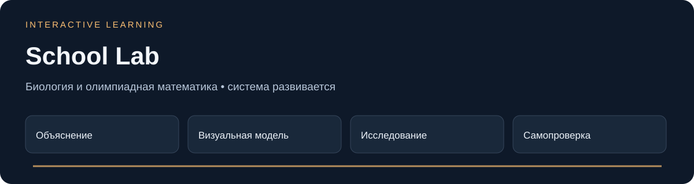

[Портфолио](../README.md) · [English](../en/projects/school.md)

# School Lab — From Textbooks to Interactive Learning

**Большая развивающаяся система интерактивного обучения. Сейчас охватывает биологию и олимпиадную математику.**

[Открыть пример одного занятия — лабораторию дробей](https://dmitrii-naumenko.github.io/portfolio/demos/school.html). Выберите долю, исследуйте равные дроби, затем перейдите к тренажёру. Это один учебный пример математического направления; интерфейс на русском.

## Задача и мой вклад

Я развиваю School Lab, чтобы превращать учебные материалы в ясные, увлекательные занятия: помочь понять тему, исследовать лежащие в её основе идеи и применить знания на практике. Каждый урок объединяет объяснения, визуальные модели, интерактивные задания и самопроверку; краткие справочные материалы доступны при необходимости.

Подготовка содержания сочетает извлечение PDF и OCR, создание материалов с помощью AI, независимую сверку с источником и автоматическую валидацию. Общая структура содержания и переиспользуемые шаблоны позволяют развивать курсы, добавлять уроки и переносить подход на новые предметы. Готовые занятия работают офлайн, без установки и аккаунта.

## Два развивающихся направления

**Биология.** Систематический курс с объяснениями, иллюстрациями, интерактивными моделями, самопроверкой и домашними заданиями. Подготовлены 27 параграфов и 19 мини-сообщений к проектам.

**Олимпиадная математика.** Развивающаяся серия уроков и модулей: от наглядного понимания идеи к рассуждению, закономерностям и задачам на перенос. Лаборатория дробей — один выбранный публичный пример этого направления.

## Существенные решения

| Решение | Зачем |
|---|---|
| Отделить содержание от представления | Общая структура уроков и шаблоны позволяют обновлять интерфейс и расширять библиотеку |
| Проверять материал независимо по источнику | Автоматическая проверка структуры дополняется проверкой смысла |
| Объединить объяснение, исследование и самопроверку | Ученик может понять идею и сразу применить её |
| Поставлять автономные HTML | Занятия доступны офлайн, без сервера, установки и аккаунта |

## Как развивается система

Новые материалы пополняют курсы и самостоятельные модули. Интерактивные модели и самопроверка проходят браузерную проверку, включая узкий экран.

Лаборатория дробей включена в библиотеку как готовый авторский материал.
